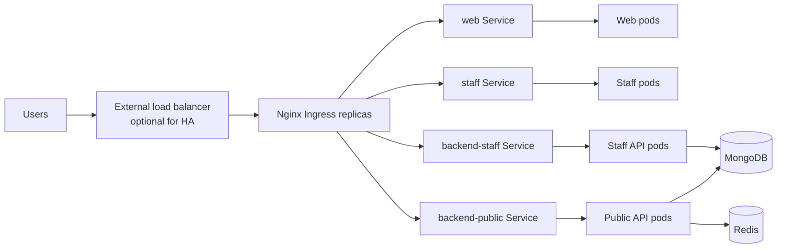

# Nginx, Load Balancing, and Scaling Plan

This plan replaces Traefik with Nginx and prepares Internity for Kubernetes-based rate limiting, caching, load balancing, and horizontal scaling.

## Target architecture



FDM remains the K3s control-plane node. Worker nodes run the workloads. Nginx receives external traffic and sends it to Kubernetes Services. Services distribute requests to ready application pods.

The first deployment can use this placement:

```text
FDM master:
  K3s control plane
  Argo CD

Worker 1:
  MongoDB
  backend-public
  backend-staff
  uploads volume

Worker 2:
  Nginx
  web
  staff
```

This placement matches the current `ReadWriteOnce` MongoDB and uploads volumes. The backend can be spread across both workers after shared storage is introduced.

## Phase 1: Replace Traefik with Nginx

1. Disable the K3s Traefik addon.
2. Install the `ingress-nginx` controller.
3. Change `ingressClassName: traefik` to `ingressClassName: nginx` in `infra/k8s/base/ingress.yaml`.
4. Remove the Traefik `Middleware` resource.
5. Replace the staff API prefix handling with Nginx rewrite annotations.
6. Keep the existing paths:

   ```text
   /          -> web
   /staff     -> staff
   /api       -> backend-public
   /staff-api -> backend-staff
   ```

7. Set the Nginx request body limit to at least `10m` because the application accepts uploads up to 10 MB.

Nginx should be deployed inside Kubernetes as the ingress controller rather than as an unmanaged process on the VM. This allows it to use Kubernetes Services and remain compatible with pod scaling.

## Phase 2: Add Nginx rate limiting

Create separate Ingress resources when different paths need different limits.

Suggested starting limits:

| Route          | Policy                                                          |
| -------------- | --------------------------------------------------------------- |
| `/api/auth/*`  | Strict per-IP limit for sign-in, activation, and password reset |
| `/api/*`       | Normal public API limit                                         |
| `/staff-api/*` | Normal staff API limit plus the application staff-IP allowlist  |
| `/assets/*`    | No aggressive limit                                             |

Example annotations:

```yaml
metadata:
  annotations:
    nginx.ingress.kubernetes.io/limit-rps: "30"
    nginx.ingress.kubernetes.io/limit-connections: "20"
    nginx.ingress.kubernetes.io/proxy-body-size: "10m"
```

Keep the backend rate limits in `apps/backend/src/lib/rate-limit.ts`. Nginx protects the edge by client IP. The backend protects account-specific actions such as password failures, AI usage, invitations, and uploads.

The backend uses Redis for shared rate-limit counters when `REDIS_URL` is set.
If Redis is unavailable, it temporarily falls back to process-local counters and
logs the degraded mode so a Redis outage does not take the API offline.

## Phase 3: Add safe caching

Cache public, immutable frontend assets:

```text
/assets/*.js
/assets/*.css
/images
/fonts
```

Use long-lived cache headers for hashed assets:

```text
Cache-Control: public, max-age=31536000, immutable
```

Do not cache:

```text
/api/*
/staff-api/*
responses containing internity_session
user profiles
submissions
uploads
```

Only add API response caching later for explicitly public, read-only endpoints. Authenticated responses must bypass the cache.

## Phase 4: Use Kubernetes Services for load balancing

Nginx must route to stable Kubernetes Services, never directly to pod IPs:

```text
Nginx
  -> backend-public Service
  -> backend-public pod 1
  -> backend-public pod 2
  -> backend-public pod 3
```

When the deployment is scaled, Kubernetes updates the Service endpoints automatically.

Example manual scaling:

```bash
kubectl scale deployment backend-public -n internity --replicas=3
kubectl scale deployment backend-staff -n internity --replicas=2
kubectl scale deployment web -n internity --replicas=3
kubectl scale deployment staff -n internity --replicas=2
```

## Phase 5: Add horizontal autoscaling

Add `HorizontalPodAutoscaler` resources for the stateless workloads:

```text
web:             2-4 replicas
staff:           2-4 replicas
backend-public:  2-6 replicas
backend-staff:   2-6 replicas
```

Use CPU and memory targets, starting around 70%. Install or verify a metrics server before enabling HPA. Resource requests and limits must be set on each Deployment.

MongoDB should not be autoscaled like a stateless application. Use a replica set, managed MongoDB, or another deliberate database scaling strategy.

## Phase 6: Make Nginx highly available

There are two load-balancing layers:

| Layer                  | Responsibility                                     |
| ---------------------- | -------------------------------------------------- |
| External load balancer | Distributes traffic across Nginx replicas or nodes |
| Kubernetes Service     | Distributes traffic across application pods        |

For the initial lab deployment, one Nginx replica on Worker 2 is acceptable:

```text
Worker 2 IP -> Nginx -> Kubernetes Services -> application pods
```

For production-style availability:

```text
Public IP or external load balancer
  -> Nginx on Worker 1
  -> Nginx on Worker 2
```

Use a cloud load balancer, HAProxy, MetalLB, or a virtual IP solution. A single worker IP remains a single point of failure.

When an external proxy or load balancer is used, preserve the client IP through `X-Forwarded-For`. Verify that Nginx, the staff frontend, and the backend agree on proxy trust settings.

## Phase 7: Remove stateful scaling blockers

The current project still has one local-state blocker for spreading API replicas across both workers:

- MongoDB is a two-member `rs0` StatefulSet. It provides a second copy, but two
  members cannot retain write quorum after either member fails; use three
  members or managed MongoDB for production availability.
- Uploads use local `ReadWriteOnce` storage.
- Redis provides shared backend rate-limit counters, but the single Redis pod is
  still a small-cluster availability dependency.

For true multi-worker scaling, the remaining infrastructure work is:

```text
S3 or MinIO -> shared uploads
replicated Mongo storage or managed MongoDB
```

After these changes, remove the backend node restriction and add topology spread constraints or pod anti-affinity so replicas are distributed across workers.

## Phase 8: Keep the deployment GitOps-based

Store the changes in the existing Kustomize structure:

```text
infra/k8s/base/ingress.yaml
infra/k8s/base/hpa.yaml
infra/k8s/base/nginx-config.yaml       # if custom Nginx settings are needed
infra/k8s/overlays/production/
```

The release flow remains:

```text
git push
  -> GitHub Actions validates and builds images
  -> deployment pull request is created
  -> deployment pull request is merged
  -> Argo CD syncs Kubernetes
  -> Kubernetes rolls out and scales pods
```

Do not commit production secrets. Continue creating `internity-secrets` from the protected environment file or use a dedicated secret manager.

## Validation checklist

The implementation is ready when these checks pass:

```bash
kubectl get pods -n internity -o wide
kubectl get ingress -n internity
kubectl get endpointslice -n internity
kubectl get hpa -n internity
```

Validate the following behavior:

- The application opens through the worker IP.
- No Traefik pods or Traefik Ingress resources remain.
- Nginx returns `429` after the configured rate limit.
- Static assets return the expected cache headers.
- Authenticated responses are not cached.
- Scaling an API from one to three replicas keeps requests working.
- Deleting one application pod causes no visible outage.
- HPA increases and decreases replicas under load.
- Staff IP restrictions still work through Nginx.
- `X-Forwarded-For` contains the real client address.
- MongoDB and uploads remain available after normal pod restarts.

## Recommended implementation order

1. Replace Traefik with Nginx and verify routing.
2. Add rate limiting and request-size limits.
3. Add static asset caching.
4. Scale stateless Deployments manually and verify Service load balancing.
5. Add HPA and verify the metrics server.
6. Add Redis for shared rate limits.
7. Add a two-member MongoDB replica set for a second copy; use three members
   or managed MongoDB when write availability is required.
8. Add shared uploads storage.
9. Add a second Nginx replica and an external load balancer.

Phases 1-7 are implemented in this repository. Phases 8-9 remain deployment
choices for the cluster's availability and storage budget.
